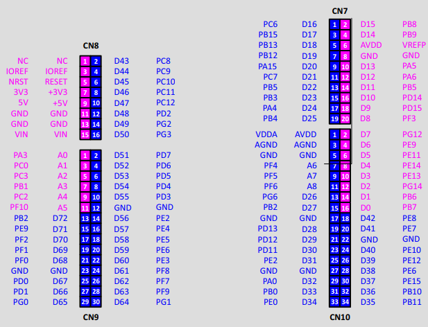

# NUCLEO-144 board pin outs

Pinout for CN7, CN8, CN9 and CN10 (pink is Arduino compatible).

## CN7 Pinout

| Pin  | Pin Name | Signal Name             | STM32H7 Pin | MCU Function         |
|------|----------|-------------------------|-------------|----------------------|
| 1    | D16      | I2S_A_MCK               | PC6         | I2S_2                |
| 2    | D15      | I2C_A_SCL               | PB8         | I2C_1_SCL            |
| 3    | D17      | I2S_A_SD                | PB15        | I2S_2                |
| 4    | D14      | I2C_A_SDA               | PB9         | I2C_1_SDA            |
| 5    | D18      | I2S_A_CK                | PB13 (1)    | I2S_2                |
| 6    | VREFP    | VREFP                   | -           | VDDA/VREFP           |
| 7    | D19      | I2S_A_WS                | PB12        | I2S_2                |
| 8    | GND      | GND                     | -           | -                    |
| 9    | D20      | I2S_B_WS                | PA15        | I2S_3                |
| 10   | D13      | SPI_A_SCK               | PA5         | SPI1_SCK             |
| 11   | D21      | I2S_B_MCK               | PC7         | I2S_3                |
| 12   | D12      | SPI_A_MISO              | PA6         | SPI1_MISO            |
| 13   | D22      | I2S_B_SD / SPI_B_MOSI   | PB5         | I2S_3 / SPI3         |
| 14   | D11      | SPI_A_MOSI / TIM_E_PWM1 | PA7 (3)     | SPI1_MOSI / TIM3_CH2 |
| 15   | D23      | I2S_B_CK / SPI_B_SCK    | PB3         | I2S_3 / SPI3         |
| 16   | D10      | SPI_A_CS / TIM_B_PWM3   | PD14        | SPI1_CS / TIM4_CH3   |
| 17   | D24      | SPI_B_NSS               | PA4         | SPI3                 |
| 18   | D9       | TIM_B_PWM2              | PD15        | TIM4_CH4             |
| 19   | D25      | SPI_B_MISO              | PB4         | SPI3                 |
| 20   | D8       | I/O                     | PF3         | -                    |

1. PB13 is used as `I2S_A_CK` and connected to CN7 pin 5. If JP6 is ON, it is also connected to
Ethernet PHY as `RMII_TXD1`. In this case, only one function of the Ethernet or `I2S_A` must be used.
2. PA7 is used as D11 and connected to CN7 pin 14. If SB31 is ON, it is also connected to Ethernet
PHY as RMII_CRS_DV. In this case, only one function of the Ethernet or D11 must be used.

## CN8 Pinout

| Pin | Pin Name | Signal Name           | STM32H7 Pin | MCU Function       |
|-----|----------|-----------------------|-------------|--------------------|
| 1   | NC       | NC                    | -           | -                  |
| 2   | D43      | SDMMC_D0              | PC8         | SDMMC              |
| 3   | IOREF    | IOREF                 | -           | 3.3 V reference    |
| 4   | D44      | SDMMC_D1 / I2S_A_CKIN | PC9         | SDMMC / I2S_CKIN   |
| 5   | NRST     | NRST                  | NRST        | RESET              |
| 6   | D45      | SDMMC_D2              | PC10        | SDMMC              |
| 7   | 3V3      | 3V3                   | -           | 3.3 V input/output |
| 8   | D46      | SDMMC_D3              | PC11        | SDMMC              |
| 9   | 5V       | 5V                    | -           | 5 V output         |
| 10  | D47      | SDMMC_CK              | PC12        | SDMMC              |
| 11  | GND      | GND                   | -           | Ground             |
| 12  | D48      | SDMMC_CMD             | PD2         | SDMMC              |
| 13  | GND      | GND                   | -           | Ground             |
| 14  | D49      | I/O                   | PG2         | -                  |
| 15  | VIN      | VIN                   | -           | Power input        |
| 16  | D50      | I/O                   | PG3         | -                  |

## CN9 Pinout

| Pin | Pin Name | Signal Name  | STM32H7 Pin | MCU Function            |
|-----|----------|--------------|-------------|-------------------------|
| 1   | A0       | ADC          | PA3         | ADC12_INP15             |
| 2   | D51      | USART_B_SCLK | PD7         | USART_2                 |
| 3   | A1       | ADC          | PC0         | ADC123_INP10            |
| 4   | D52      | USART_B_RX   | PD6         | USART_2                 |
| 5   | A2       | ADC          | PC3         | ADC12_INP13             |
| 6   | D53      | USART_B_TX   | PD5         | USART_2                 |
| 7   | A3       | ADC          | PB1         | ADC12_INP5              |
| 8   | D54      | USART_B_RTS  | PD4         | USART_2                 |
| 9   | A4       | ADC          | PC2 / PB9   | ADC123_INP12 / I2C1_SDA |
| 10  | D55      | USART_B_CTS  | PD3         | USART_2                 |
| 11  | A5       | ADC          | PF10 / PB8  | ADC3_INP6 / I2C1_SCL    |
| 12  | GND      | GND          | -           | -                       |
| 13  | D72      | COMP1_INP    | PB2         | COMP1_INP               |
| 14  | D56      | SAI_A_MCLK   | PE2 (1)     | SAI_1_A                 |
| 15  | D71      | COMP2_INP    | PE9         | COMP2_INP               |
| 16  | D57      | SAI_A_FS     | PE4         | SAI_1_A                 |
| 17  | D70      | I2C_B_SMBA   | PF2         | I2C2                    |
| 18  | D58      | SAI_A_SCK    | PE5         | SAI_1_A                 |
| 19  | D69      | I2C_B_SCL    | PF1         | I2C2                    |
| 20  | D59      | SAI_A_SD     | PE6         | SAI_1_A                 |
| 21  | D68      | I2C_B_SDA    | PF0         | I2C2                    |
| 22  | D60      | SAI_B_SD     | PE3         | SAI_1_B                 |
| 23  | GND      | GND          | -           | -                       |
| 24  | D61      | SAI_B_SCK    | PF8         | SAI_1_B                 |
| 25  | D67      | CAN_RX       | PD0         | CAN_1                   |
| 26  | D62      | SAI_B_MCLK   | PF7         | SAI_1_B                 |
| 27  | D66      | CAN_TX       | PD1         | CAN_1                   |
| 28  | D63      | SAI_B_FS     | PF9         | SAI_1_B                 |
| 29  | D65      | I/O          | PG0         | -                       |
| 30  | D64      | I/O          | PG1         | -                       |

1. CN9 pin 14 (PE2) is shared with CN10 pin 25 (`QSPI_BK1_IO2`).
Only one function may be used at a time.

## CN10 Pinout

| Pin | Pin Name | Signal Name   | STM32H7 Pin | MCU Function |
|-----|----------|---------------|-------------|--------------|
| 1   | AVDD     | VDDA          | -           | Analog VDD   |
| 2   | D7       | I/O           | PG12        | I/O          |
| 3   | AGND     | AGND          | -           | Analog GND   |
| 4   | D6       | TIMER_A_PWM1  | PE9         | TIM1_CH1     |
| 5   | GND      | GND           | -           | GND          |
| 6   | D5       | TIMER_A_PWM2  | PE11        | TIM1_CH2     |
| 7   | A6       | ADC_A_IN      | PF4         | ADC3_INP9    |
| 8   | D4       | I/O           | PE14        | I/O          |
| 9   | A7       | ADC_B_IN      | PF5         | ADC3_INP4    |
| 10  | D3       | TIMER_A_PWM3  | PE13        | TIM1_CH3     |
| 11  | A8       | ADC_C_IN      | PF6         | ADC3_INP8    |
| 12  | D2       | I/O           | PG14        | I/O          |
| 13  | D26      | QSPI_CS       | PG6         | QSPI1_NCS    |
| 14  | D1       | USART_A_TX    | PB6         | LPUART1      |
| 15  | D27      | QSPI_CLK      | PB2         | QSPI1_CLK    |
| 16  | D0       | USART_A_RX    | PB7         | LPUART1      |
| 17  | GND      | GND           | -           | GND          |
| 18  | D42      | TIMER_A_PWM1N | PE8         | TIM1_CH1N    |
| 19  | D28      | QSPI_BK1_IO3  | PD13        | QSPI1_IO3    |
| 20  | D41      | TIMER_A_ETR   | PE7         | TIM1_ETR     |
| 21  | D29      | QSPI_BK1_IO1  | PD12        | QSPI1_IO1    |
| 22  | GND      | GND           | -           | GND          |
| 23  | D30      | QSPI_BK1_IO0  | PD11        | QSPI1_IO0    |
| 24  | D40      | TIMER_A_PWM2N | PE10        | TIM1_CH2N    |
| 25  | D31      | QSPI_BK1_IO2  | PE2 (1)     | QSPI1_IO2    |
| 26  | D39      | TIMER_A_PWM3N | PE12        | TIM1_CH3N    |
| 27  | GND      | -             | -           | -            |
| 28  | D38      | TIMER_A_BKIN2 | PE6         | TIM1_BKIN2   |
| 29  | D32      | TIM_C_PWM1    | PA0         | TIM2_CH1     |
| 30  | D37      | TIMER_A_BKIN1 | PE15        | TIM1_BKIN1   |
| 31  | D33      | TIM_D_PWM1    | PB0         | TIM3_CH3     |
| 32  | D36      | TIMER_C_PWM2  | PB10        | TIM2_CH3     |
| 33  | D34      | TIM_B_ETR     | PE0         | TIM4_ETR     |
| 34  | D35      | TIMER_C_PWM3  | PB11        | TIM2         |

1. CN10 pin 25 (PE2) is shared with CN9 pin 14 (`QSPI_BK1_IO2`).
Only one function may be used at a time.
